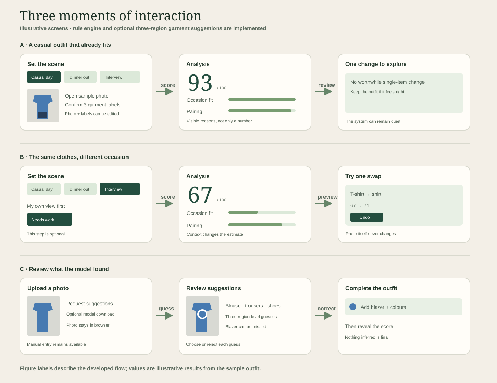

# Outfit, considered.: a contextual outfit checker

**Assignment:** Assignment 2 — Project Report  
**Module:** Intelligent Interactive Systems  
**Total report word count:** 1,074 (abstract 142 + main report 932)
**Abstract word count:** 142
**Repository:** [add public GitHub URL before submission]  
**README:** [add public README URL before submission]  
**Submitted commit:** [replace with final commit SHA]

## Abstract

An outfit rating can appear objective even though clothing choices depend on occasion and personal preference. I developed *Outfit, considered.*, a no-cost web prototype that makes those assumptions visible. A user chooses an occasion, uploads a photo, optionally requests browser-run garment suggestions, then confirms or adds items and colours. They can record their own judgement before advice. A local rule engine explains four score components and offers one reversible garment swap. Three AI-generated photos provide repeatable walkthroughs; their labels are prefilled demonstration data, separate from the vision model. The photograph stays in the browser. A user-picked skin-area colour offers descriptive contrast information but does not change the score, and gender is not inferred. The model checks three fixed image regions, so it can miss layers. This prototype demonstrates a correctable human–AI interaction; it does not establish fashion expertise or improved decisions.

## Design rationale and project explanation

### Problem, users and scope

Someone deciding what to wear may want specific advice, yet a bare score can obscure its assumptions and encourage acceptance of advice that ignores their purpose. This prototype compares one outfit with a casual day, dinner or interview. It evaluates confirmed clothing attributes, never the person’s body or attractiveness. The developed scope includes optional three-region garment guesses, manual correction, colour sampling, a contextual score and one reversible suggestion. Whole-outfit detection, shopping, wardrobe history and claims across cultures remain outside scope.

### Why the interaction starts with the person

The user sets occasion and style direction before advice because these are personal context, not facts reliably inferred from pixels. An optional “own view” asks whether the outfit needs work; it locks when the score is revealed and is displayed, not scored. This develops my Assignment 1 question about judgement before AI advice. Buçinca, Malaya and Gajos (2021) found that three cognitive-forcing designs together reduced overreliance on wrong AI advice in an ingredient-choice task, but added effort without establishing a general overall performance gain. I therefore made the self-assessment optional and do not claim it improves outfit choices.

Week 1’s sensing–interpretation–action–feedback sequence shaped the upload, optional model, editing and score loop. The browser crops the upper body, lower body and footwear regions. A CLIP model ranks garment descriptions for each crop (Radford et al., 2021); it does not locate every object or produce calibrated confidence. The user reviews each guess and supplies missed layers. This responds to Week 3’s warning that plausible vision-language output can contain absent objects. Prefilled sample labels are explicitly marked as demonstration data, not model results.

The score appears with a breakdown and a reason for each part. Week 2’s mental-model and cognitive-load lectures suggest making the system’s assumptions visible without making the user inspect a long explanation. The interface therefore shows four short reasons, not a paragraph of generated prose. It also acknowledges actions immediately and updates the score after edits, applying Week 2’s feedback-timing and gulf-of-evaluation concepts. Undo keeps a suggested swap exploratory rather than committing the user to it. Amershi et al. (2019) similarly recommend supporting correction in human–AI interfaces.

The score appears only after a photo, two garments and colours for every item. Otherwise a number would imply knowledge the system lacks. Missing footwear or an incomplete main outfit produces a qualification. One suggested swap lets the user compare a specific counterfactual; several simultaneous changes would obscure why the score moved.

### What the intelligence does

The implemented engine combines fixed weights—occasion fit 40%, garment pairing 25%, colour balance 20% and stated preference 15%—with contextual rules. For example, trainers and jeans receive a pairing benefit for a casual day, while trainers beside tailored trousers in an interview reduce the pairing estimate. Candidate swaps are re-scored and shown only when a single change improves the estimate by at least four points; a strong casual outfit may receive no suggestion. These rules are inspectable design hypotheses, not fashion truths. Pang, Zou and Wong (2021) show that fashion compatibility can be modelled using garment attributes and explained, but their learned model does not validate my hand-set weights or scores. A small rule base was appropriate here because it is free, reproducible and exposes precisely why a recommendation changed.

The pixel sampler averages a small user-selected patch; the editable field corrects mistakes caused by lighting or background. A separate optional tap records a skin-area colour and describes light/dark contrast with entered garments. It neither categorises skin tone nor changes the score: fixed “flattering” rules would overstate what one photographed colour establishes. Gender prediction is unnecessary because the rules use garments, occasion and expressed preference, not identity. The vague “What feels like you?” control became “Style direction”, with earth and cool tone choices that alter only the 15% preference component.

Figure 1 separates evidence and control. The photo stays in browser memory; model files download on demand, then inference runs locally. CLIP guesses and pixel colours enter editable outfit facts only after user review. The rules calculate reasons and swaps from those facts and the chosen context. Undo restores the prior state without reprocessing the image. The own-view answer is shown beside the score, never fed into it. Following Week 4’s context-engineering discussion, the app keeps current-task state rather than a persistent style profile. An internet connection is needed for the first model download, but manual entry and scoring do not need it.

*Figure 1. Implemented browser flow and optional model-file download.*

### Developed interaction and checks

Figure 2 shows three developed paths. The casual sample’s T-shirt, jeans and trainers score 93 with no needless swap. Changing its context to interview lowers the estimate to 67; previewing a shirt raises it to 74, and Undo restores 67. On the new interview sample, the model suggested blouse, trousers and smart shoes but missed the blazer; the user can add it before scoring. These are prototype outputs and one smoke test, not measured accuracy or user benefit. All three sample photos are AI-generated with prefilled labels.

*Figure 2. Three interactions showing restraint, a reversible swap and correction of garment guesses.*

The project began with manual labels because a paid vision service conflicted with the no-cost constraint. I later added optional on-device CLIP inference and kept confirmation mandatory. An initial smaller model failed to load through the browser pipeline; a documented compatible model produced usable guesses on the interview sample, though it missed a layer. I added two more samples to expose different outfits and clarified the two personalisation controls. Earlier testing found that an empty result panel stayed visible after scoring and that a file named `.png` contained HEIC data; both were fixed. Eight automated checks cover rule and colour behaviour. These checks establish implementation consistency, not fashion validity. The README records the decisions and AI assistance.

## References

Amershi, S. *et al.* (2019) ‘Guidelines for Human-AI Interaction’, *Proceedings of CHI 2019*. https://doi.org/10.1145/3290605.3300233.

Buçinca, Z., Malaya, M.B. and Gajos, K.Z. (2021) ‘To Trust or to Think: Cognitive Forcing Functions Can Reduce Overreliance on AI in AI-Assisted Decision-Making’, *Proceedings of the ACM on Human-Computer Interaction*, 5(CSCW1). https://doi.org/10.1145/3449287.

Hugging Face (2026) *Transformers.js: zero-shot image classification pipeline*. https://huggingface.co/docs/transformers.js/api/pipelines.

Pang, K., Zou, X. and Wong, W.K. (2021) ‘Modeling Fashion Compatibility With Explanation by Using Bidirectional LSTM’, *CVPR Workshops*, pp. 3894–3898. https://openaccess.thecvf.com/content/CVPR2021W/CVFAD/html/Kaicheng_Modeling_Fashion_Compatibility_With_Explanation_by_Using_Bidirectional_LSTM_CVPRW_2021_paper.html.

Radford, A. *et al.* (2021) ‘Learning Transferable Visual Models From Natural Language Supervision’, *Proceedings of the 38th International Conference on Machine Learning*, 139, pp. 8748–8763. https://proceedings.mlr.press/v139/radford21a.html.

University of Birmingham (2026) *Intelligent Interactive Systems*, Weeks 1–4 lecture slides, supplied in the module.
