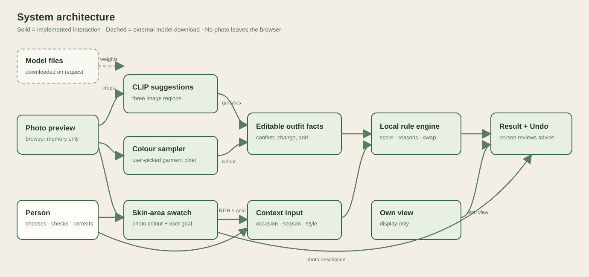

# Outfit, considered.: a contextual outfit checker

**Assignment:** Assignment 2 — Project Report  
**Module:** Intelligent Interactive Systems  
**Total report word count:** 1,156 (abstract 153 + main report 1,003)  
**Abstract word count:** 153  
**Repository:** [add public GitHub URL before submission]  
**README:** [add public README URL before submission]  
**Submitted commit:** [replace with final commit SHA]

## Abstract

An outfit rating is easy to present as an objective verdict, although whether clothes work together depends on the occasion and the wearer’s preferences. I developed *Outfit, considered.*, a no-cost web prototype that makes that context explicit. A user chooses an occasion, uploads a photo, identifies visible garments, and can sample and correct colours from the image. An optional self-assessment records their view before the system reveals a score. A local rule engine then explains four score components and offers one garment swap whose estimated effect can be previewed and undone. The photograph remains in the browser. Automatic garment recognition is not implemented: the sample photo has prefilled labels, while users label their own uploads. This deliberately bounded implementation demonstrates an inspectable human–system loop without presenting a simulated vision result as a real one. It does not establish that the rule weights represent expert fashion judgement or that the interface improves decisions.

## Design rationale and project explanation

### Problem, users and scope

Someone deciding what to wear may want specific advice, yet a bare score can obscure the assumptions behind it and encourage acceptance of a judgement that ignores their purpose. This prototype is for an individual comparing an outfit with one of three settings: a casual day, dinner out or an interview. It evaluates selected clothing attributes, not the person’s body or attractiveness. The scope is one photo, manually confirmed garment types, local colour sampling, a contextual score and one reversible suggestion. Shopping, wardrobe history, automatic garment detection and claims about suitability for every culture or setting are outside this version.

### Why the interaction starts with the person

The user sets the occasion and style preference before seeing advice, because those are personal context rather than facts the system can infer reliably from pixels. An optional “own view” asks whether the outfit needs work or works well. This choice develops my Assignment 1 question about judgement before AI advice. Buçinca, Malaya and Gajos (2021) found that three cognitive-forcing designs together reduced overreliance on wrong AI advice in an ingredient-choice task, but the designs added effort and did not establish a general improvement in overall performance. I therefore made the self-assessment optional and do not claim it improves outfit choices.

Week 1’s “sensing–interpretation–action–feedback” spine informed the upload, colour sample, rule engine and correction loop. The image supplies pixel evidence, but the browser cannot reliably identify garment types in this version. A user enters those labels, and each sampled colour is presented as a suggestion that can be changed. This follows Week 3’s warning that even a vision-language model may add plausible but absent objects: a confident-looking garment label should not be silently treated as verified. The explicit boundary also prevents the sample’s prefilled labels being mistaken for live recognition.

The score appears with a breakdown and a reason for each part. Week 2’s mental-model and cognitive-load lectures suggest making the system’s assumptions visible without making the user inspect a long explanation. The interface therefore shows four short reasons, not a paragraph of generated prose. It also acknowledges actions immediately and updates the score after edits, applying the feedback-timing and gulf-of-evaluation concepts from Weeks 2–3. Undo keeps a suggested swap exploratory rather than committing the user to it. Amershi et al. (2019) similarly recommend supporting correction in human–AI interfaces.

The score is revealed only after the user has provided enough information: a photo and at least two garments. With fewer pieces, a number would imply knowledge of an outfit the system has not seen. Missing footwear or an incomplete main outfit produces a visible qualification alongside any estimate. A suggested change is limited to one garment so the user can compare a specific counterfactual with the original; offering many simultaneous substitutions would make the cause of a changed score difficult to trace.

### What the intelligence does

The implemented engine combines fixed weights—occasion fit 40%, garment pairing 25%, colour balance 20% and stated preference 15%—with contextual rules. For example, trainers and jeans receive a pairing benefit for a casual day, while trainers beside tailored trousers in an interview reduce the pairing estimate. Candidate swaps are re-scored and shown only when a single change improves the estimate by at least four points; a strong casual outfit may receive no suggestion. These rules are inspectable design hypotheses, not fashion truths. Pang, Zou and Wong (2021) show that fashion compatibility can be modelled using garment attributes and explained, but their learned model does not validate my hand-set weights or scores. A small rule base was appropriate here because it is free, reproducible and exposes precisely why a recommendation changed.

The colour sampler averages pixels around a user-selected point and maps them to a named colour. Clicking skin or background can produce the wrong suggestion; the editable colour field is the recovery path. The current server only serves static files. The photo is held in browser memory and is not transmitted to a model or server. The planned vision component is shown with a dashed connection in Figure 1, separate from the implemented path.

Figure 1 also separates the source of each claim: photo pixels supply only a colour suggestion, while garment categories come from the user. Both enter an editable outfit-facts state alongside occasion and preference. The rule engine uses that state to calculate reasons, a score and candidate swaps; preview modifies the facts temporarily, and Undo restores them. This separation matters technically because a correction can be re-scored without reprocessing the photo. No account, persistent profile or remote inference is required. Automatic recognition would need its own uncertainty handling before its labels could enter the same editable state.

*Figure 1. Implemented local flow and planned garment-recognition boundary.*

### Developed interaction and checks

Figure 2 illustrates three developed paths. In the sample, a blue T-shirt, navy jeans and white trainers score 93 for a casual day, and no needless change appears. With the same labels under “interview”, the estimate falls to 67; changing the T-shirt to a shirt in the preview raises it to 74, and Undo restores 67. In a personal upload, the user identifies garments, taps a garment to sample colour, and can correct the name before or after scoring. These values are outputs of the prototype rules, not measured user outcomes. The sample photograph was AI-generated and its garment labels are prefilled demonstration data.

*Figure 2. Three interactions showing no suggestion, a reversible swap and a correctable colour sample.*

The project changed substantially from the initial idea of automatic photo-based scoring. A live vision service would have introduced cost or access dependencies, so I developed local pixel sensing and explicit garment entry while keeping automatic recognition visibly planned. I later added the optional pre-score view to connect the design to Assignment 1 without making a costly forcing step compulsory. Five automated scenarios check context changes, reversible suggestions, strong-outfit restraint, incomplete-input handling and common colour mapping. A browser walkthrough exposed an empty panel still showing after scoring; I fixed the hidden-state styling and replayed the score, swap, undo and colour correction. These checks establish consistency with the implemented rules, not fashion validity or user benefit. The README records AI assistance and the development decisions; the repository commit identifies the submitted version.

## References

Amershi, S. *et al.* (2019) ‘Guidelines for Human-AI Interaction’, *Proceedings of CHI 2019*. https://doi.org/10.1145/3290605.3300233.

Buçinca, Z., Malaya, M.B. and Gajos, K.Z. (2021) ‘To Trust or to Think: Cognitive Forcing Functions Can Reduce Overreliance on AI in AI-Assisted Decision-Making’, *Proceedings of the ACM on Human-Computer Interaction*, 5(CSCW1). https://doi.org/10.1145/3449287.

Pang, K., Zou, X. and Wong, W.K. (2021) ‘Modeling Fashion Compatibility With Explanation by Using Bidirectional LSTM’, *CVPR Workshops*, pp. 3894–3898. https://openaccess.thecvf.com/content/CVPR2021W/CVFAD/html/Kaicheng_Modeling_Fashion_Compatibility_With_Explanation_by_Using_Bidirectional_LSTM_CVPRW_2021_paper.html.

University of Birmingham (2026) *Intelligent Interactive Systems*, Weeks 1–4 lecture slides, supplied in the module.
